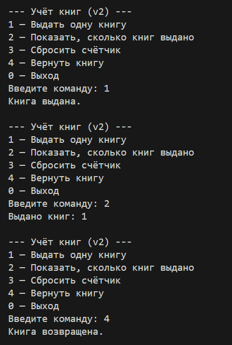

# Проект «Учёт книг»

Простая консольная утилита на Python для подсчёта количества книг, выданных читателям в данный момент.

## Как запустить

Убедитесь, что у вас установлен Python 3. Откройте терминал в папке с проектом и выполните команду:

* Для первой версии: `python app_v1.py`
* Для второй версии: `python app_v2.py`

## Как пользоваться меню

После запуска программа выводит список доступных действий. Введите нужную цифру и нажмите `Enter`:

* `1` — выдать одну книгу (увеличивает счётчик на 1).
* `2` — показать текущее количество выданных книг.
* `3` — сбросить счётчик до 0.
* `4` — вернуть книгу (уменьшает счётчик на 1; доступно только в `app_v2.py`).
* `0` — завершить работу программы.

## Скриншот работы

### Выдача и возврат книги (`app_v2.py`)

